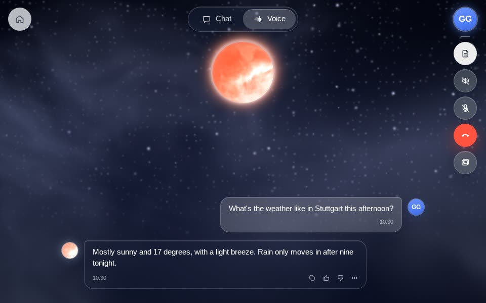
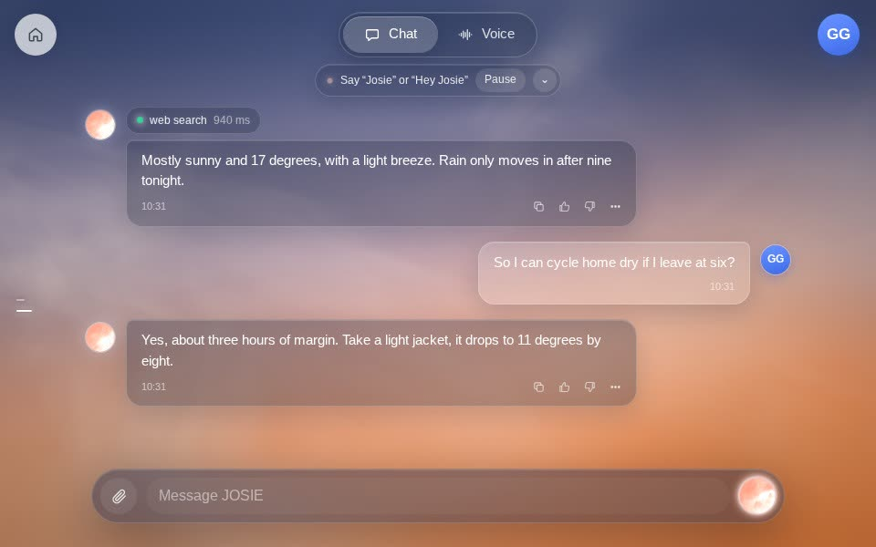
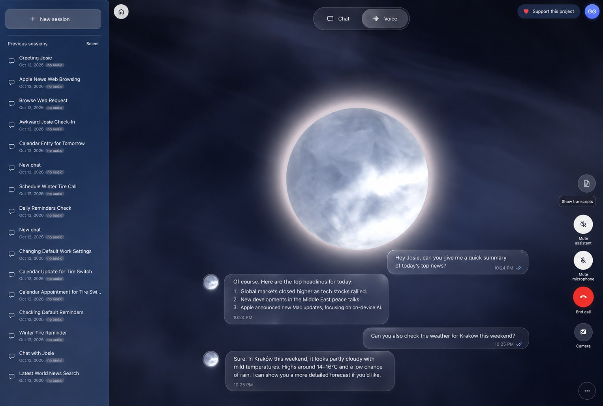
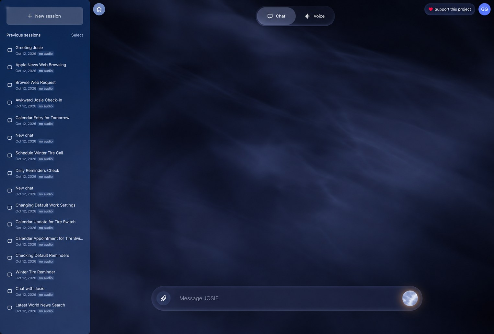

  

<h1 align="center">JOSIE-Voice</h1>

  <b>Talk to your Mac.</b> 
  A voice and chat assistant that listens, knows who's speaking, and talks back with a natural voice. 
  Hearing, voice recognition and speech all run on your Mac, so your voice never leaves it.

  <a href="https://github.com/Goekdeniz-Guelmez/JOSIE-Voice/releases"><b>Download for Mac</b></a> ·
  <a href="https://goekdeniz-guelmez.github.io/JOSIE-Voice/">Website</a> ·
  <a href="#install">How to install</a> ·
  <a href="#faq">FAQ</a>

  Free · Apple Silicon (M1 or newer) · macOS 14 Sonoma or newer · No account

---

## Talk or type

Switch between **Voice** and **Chat** with one tap. It's the same conversation either way: start a call, hang up, keep typing, and JOSIE remembers it all. Every conversation is saved in the sidebar.

<table>
  <tr>
    <td width="50%" align="center"></td>
    <td width="50%" align="center"></td>
  </tr>
  <tr>
    <td align="center"><b>Voice mode</b> Just talk, and JOSIE answers out loud. Live transcripts appear as you speak.</td>
    <td align="center"><b>Chat mode</b> Type when you can't talk, with web search when she needs it.</td>
  </tr>
</table>

  
  

The sky follows the real time of day, from sunrise to stars at night.

## What she can do

| | |
|---|---|
| **Real conversation** | Knows when you've finished talking. Interrupt her just by speaking. |
| **Knows your voice** | Learns you from three short phrases and tells people apart. |
| **Voices you choose** | Pick a preset, clone a voice from a short recording, or describe a new one in words. |
| **Private by design** | Hearing, voice recognition and speech run on your Mac. Your data stays on your Mac. No account. |
| **Helps with your day** | Optional Apple tools such as Reminders, Calendar, Maps and Messages drafts (you tap Send). Each one is off until you turn it on. |
| **Sees what you show it** | Turn on the camera and ask about what it sees. Needs an image-capable model. |
| **Adapts to the room** | Volume follows background noise, with echo cancellation. |
| **Living sky** | The background follows the real time of day, under Apple's Liquid Glass design. |

## How it works

JOSIE-Voice is a native Mac app built with SwiftUI and MLX Swift. Everything except the language model runs on your Mac's Apple Silicon:

- **Listening:** Silero VAD notices when you speak, and Smart Turn v3 knows when you've finished.
- **Speech recognition:** Qwen3-ASR by default, or NVIDIA Parakeet TDT 0.6B v3 (chosen in Settings).
- **Who's speaking:** WeSpeaker, ported to MLX, recognises your voice and any voices you add.
- **Speech:** Qwen3-TTS by default, with voice cloning and voice design, or Kokoro 82M (chosen in Settings).
- **The brain:** a language model in [Ollama](https://ollama.com) on your Mac (`qwen3.5:0.8b` by default). In Settings you can switch to any OpenAI-compatible service with your own key, or to Apple Intelligence on macOS 26.

After setup, everything works offline except the language model, which runs in Ollama on your Mac.

## Install

No terminal needed. Setup takes about 15 minutes, mostly waiting for downloads.

**Before you start:** a Mac with Apple Silicon (Apple menu → About This Mac should say "Chip: Apple M…"), macOS 14 or newer, about 7 GB of free space, 16 GB of memory recommended for the larger models, and internet for the first setup.

1. **Download JOSIE-Voice.** Get the latest `.dmg` from [Releases](https://github.com/Goekdeniz-Guelmez/JOSIE-Voice/releases).
2. **Move it to Applications.** Open the `.dmg`, drag JOSIE-Voice onto the Applications folder, then eject the disk.
3. **Install Ollama, JOSIE's brain.** Download it free from [ollama.com/download](https://ollama.com/download), move it to Applications and open it once. A llama icon in the menu bar means it's running.
4. **Open JOSIE-Voice.** Current builds are test builds and are ad-hoc signed. If macOS says it "can't be opened", go to **System Settings → Privacy & Security**, scroll down and click **Open Anyway**. You only need to do this once.
5. **Follow the setup.** Choose model sizes (0.6B for 8 GB Macs or for speed, 1.7B for better quality on 16 GB or more) and click **Download all**. Leave the language model on Ollama; JOSIE downloads `qwen3.5:0.8b` by herself. Allow the microphone, optionally say three phrases so she learns your voice, and click **Start talking**.

That's it. Click the orb and say hi.

### Good to know

- **Run setup again:** Settings → Setup → Run setup again.
- **Apple tools:** turn them on one by one in Settings. macOS asks permission the first time each is used.
- **Optional extras** download only if you want them: voice design (3.1 GB) and word timestamps (1.3 GB).

## FAQ

**Is it free?** Yes.

**Does my voice go to the cloud?** No. Hearing, voice recognition and speech run on your Mac, and by default the language model (Ollama) does too. If you switch to an online model, your text goes to that service.

**Do I need an account?** No.

**Does it work on Intel Macs?** No, Apple Silicon (M1 or later) only.

**Is there an iPhone or iPad version?** Not as a download yet.

**It says "Ollama isn't running".** Open Ollama from Applications, then click Recheck in JOSIE's setup.

**JOSIE can't hear me.** Open System Settings → Privacy & Security → Microphone and turn on JOSIE-Voice.

**How much space does it need?** About 5 GB of voice models plus about 1 GB for the language model, at the default small sizes.

**How do I uninstall it?** Drag JOSIE-Voice to the Trash. To remove its data and models too, delete the `JOSIE-Voice` folder in `~/Library/Application Support`.

## The JOSIE family

JOSIE-Voice comes from the JOSIE family of personality-driven language models by Gökdeniz Gülmez, trained entirely on Apple Silicon with [MLX-LM-LoRA](https://github.com/Goekdeniz-Guelmez/mlx-lm-lora). Meet the models on [Hugging Face](https://huggingface.co/Goekdeniz-Guelmez).

 

## About this repository

This repository hosts the JOSIE-Voice website and the app downloads. The source code is private.

Built with MLX Swift, Qwen3-ASR, Qwen3-TTS, Parakeet, Kokoro, Silero VAD, Smart Turn v3 and WeSpeaker. Ollama is a separate app by its own developers.

Feedback: goekdenizguelmez.ml@gmail.com · [Sponsor on GitHub](https://github.com/sponsors/Goekdeniz-Guelmez)
