

  

<h1 align="center">JOSIE-Voice</h1>

  <b>Talk to your Mac.</b> 
  A voice and chat assistant that listens, knows who's speaking, talks back with a natural voice, and takes real action in your Reminders, Calendar, Maps and Messages. 
  Hearing, voice recognition and speech all run on your Mac, so your voice never leaves it.

  <a href="https://goekdeniz-guelmez.github.io/JOSIE-Voice/"><b>Website</b></a> ·
  <a href="#faq">FAQ</a>

  Free · Apple Silicon (M1 or newer) · macOS 14 Sonoma or newer · No account

---

## Talk or type

Switch between **Voice** and **Chat** with one tap. It's the same conversation either way: start a call, hang up, keep typing, and JOSIE remembers it all. Every conversation is saved in the sidebar and in the Library.

<table>
  <tr>
    <td width="50%" align="center"><a href="docs/images/mac-call-orb-1600.webp">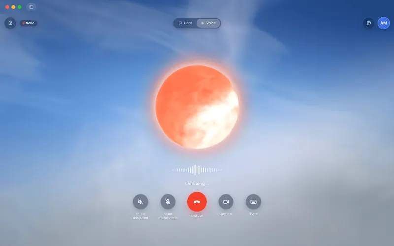</a></td>
    <td width="50%" align="center"><a href="docs/images/mac-chat-1600.webp">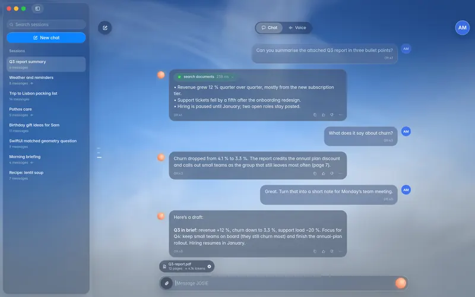</a></td>
  </tr>
  <tr>
    <td align="center"><b>Voice mode</b> Just talk, and JOSIE answers out loud. Live transcripts appear as you speak. (mockup)</td>
    <td align="center"><b>Chat mode</b> Type when you can't talk, and attach documents to ask about them. (mockup)</td>
  </tr>
</table>

### Demo videos

Click a picture to play the clip.

<table>
  <tr>
    <td width="33%" align="center" valign="top"><a href="docs/videos/josie-mac-call.mp4">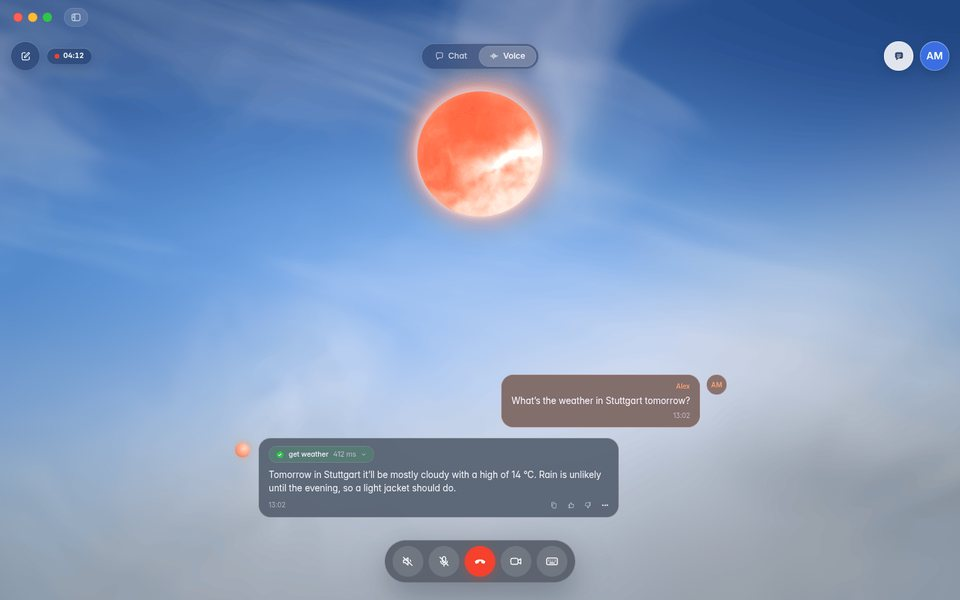</a> ▶ A voice call with the live transcript (mockup)</td>
    <td width="33%" align="center" valign="top"><a href="docs/videos/josie-transcript-morph.mp4">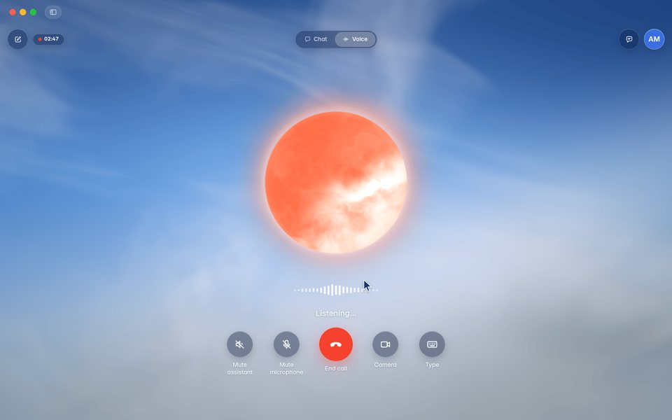</a> ▶ Show or hide the transcript mid-call (mockup)</td>
    <td width="33%" align="center" valign="top"><a href="docs/videos/josie-sky-day-night.mp4">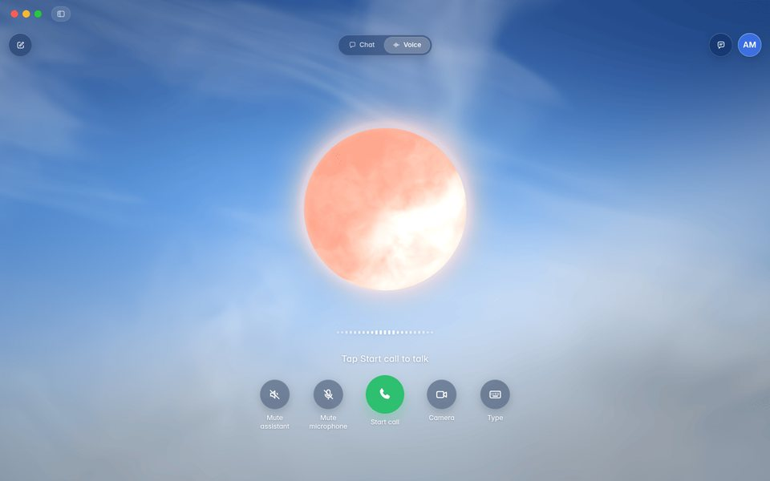</a> ▶ The sky follows the time of day (mockup)</td>
  </tr>
  <tr>
    <td width="33%" align="center" valign="top"> ▶ Your Library as a 3D embedding map (mockup)</td>
    <td width="33%" align="center" valign="top"><a href="docs/videos/josie-menu-bar-api.mp4">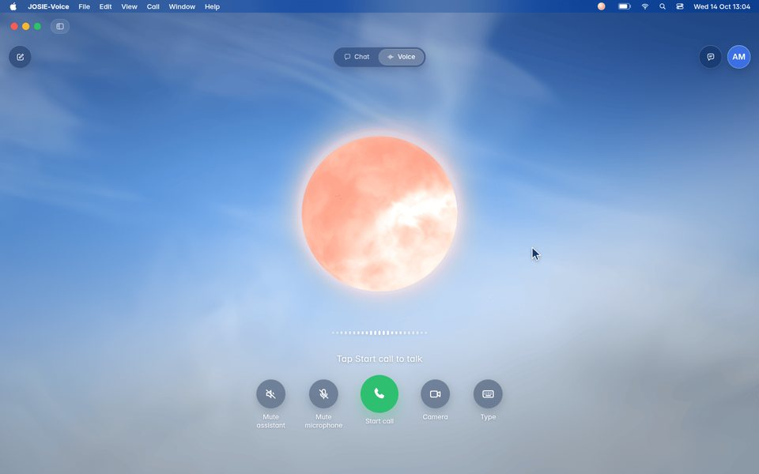</a> ▶ Menu bar extra with the local API server (mockup)</td>
  </tr>
</table>

### Screenshots

<b>Mac · Calls & chat</b> (8)

 

<table>
  <tr>
    <td width="33%" align="center" valign="top"> Voice: just talk, and JOSIE answers out loud. (mockup)</td>
    <td width="33%" align="center" valign="top"><a href="docs/images/mac-call-1600.webp">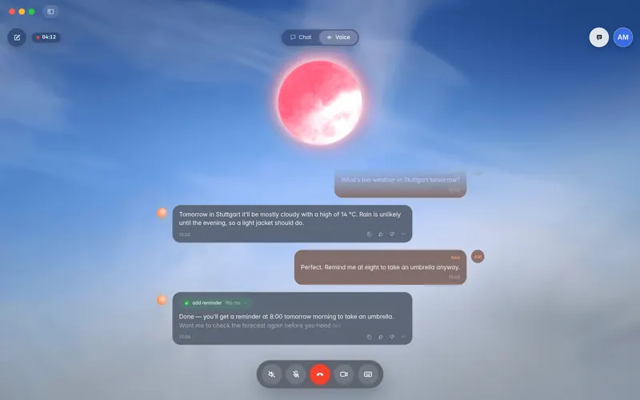</a> Live transcripts appear as you speak. (mockup)</td>
    <td width="33%" align="center" valign="top"> Chat: type when you can't talk. (mockup)</td>
  </tr>
  <tr>
    <td width="33%" align="center" valign="top"><a href="docs/images/mac-attachments-drop-1600.webp">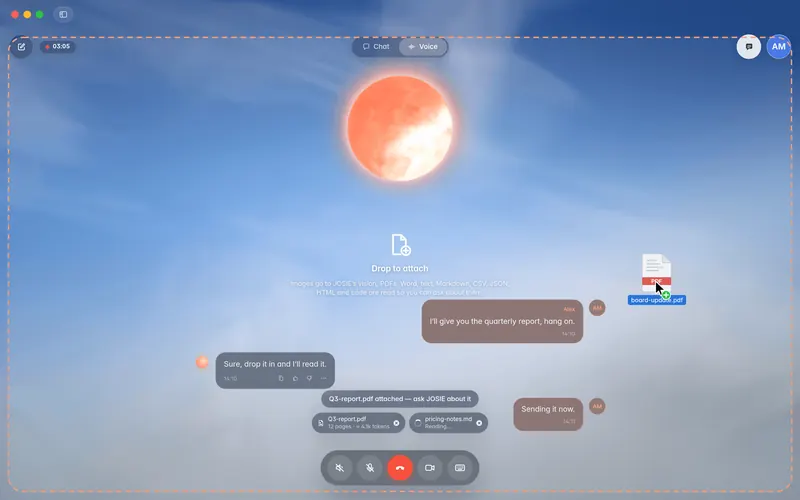</a> Drop a PDF onto a call to talk about it. (mockup)</td>
    <td width="33%" align="center" valign="top"><a href="docs/images/mac-camera-1600.webp">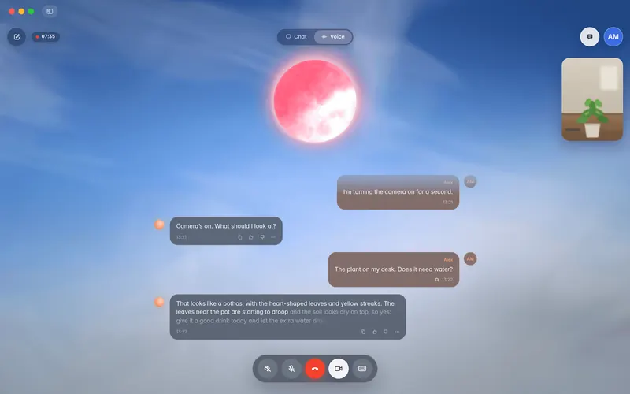</a> Turn on the camera and ask what it sees. (mockup)</td>
    <td width="33%" align="center" valign="top"><a href="docs/images/mac-mute-chip-1600.webp">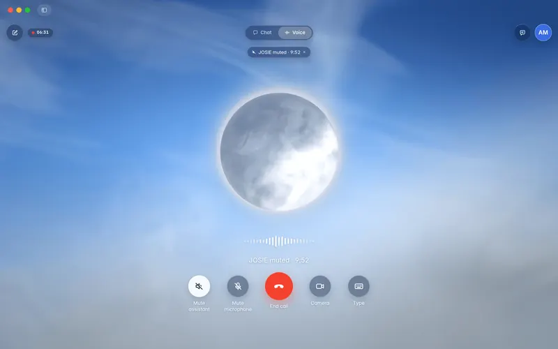</a> &ldquo;Be quiet for ten minutes&rdquo;: a timed mute. (mockup)</td>
  </tr>
  <tr>
    <td width="33%" align="center" valign="top"><a href="docs/images/mac-sky-golden-hour-1600.webp">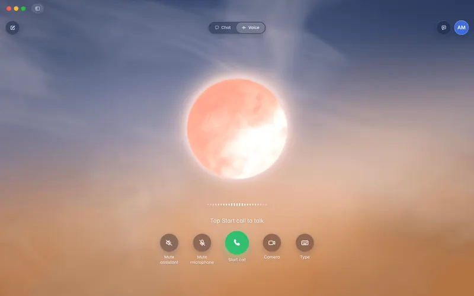</a> Golden hour behind the orb. (mockup)</td>
    <td width="33%" align="center" valign="top"><a href="docs/images/mac-sky-night-1600.webp">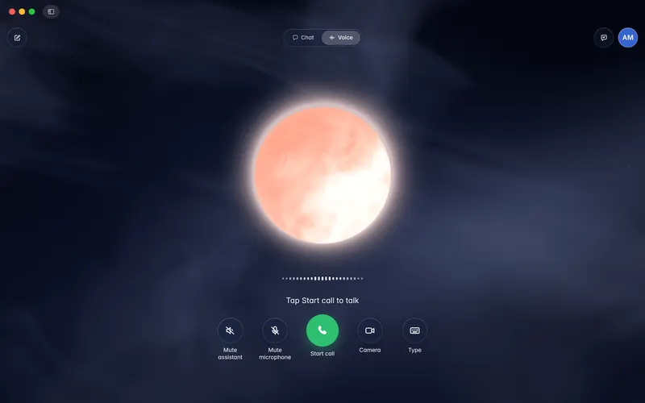</a> Stars at night. (mockup)</td>
  </tr>
</table>

<b>Mac · Library & embeddings</b> (3)

 

<table>
  <tr>
    <td width="33%" align="center" valign="top"><a href="docs/images/mac-library-1600.webp">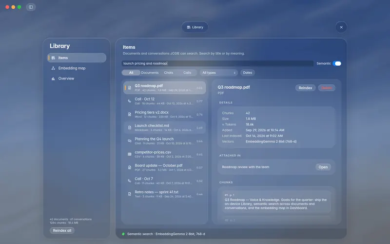</a> Every document and conversation, searchable in the Library. (mockup)</td>
    <td width="33%" align="center" valign="top"><a href="docs/images/mac-embedding-map-1600.webp">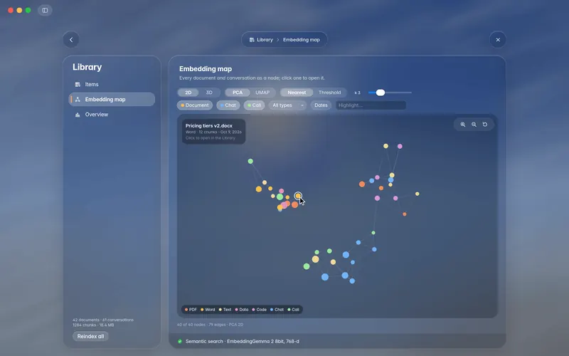</a> The embedding map in 2D. (mockup)</td>
    <td width="33%" align="center" valign="top"><a href="docs/images/mac-embedding-map-3d-1600.webp">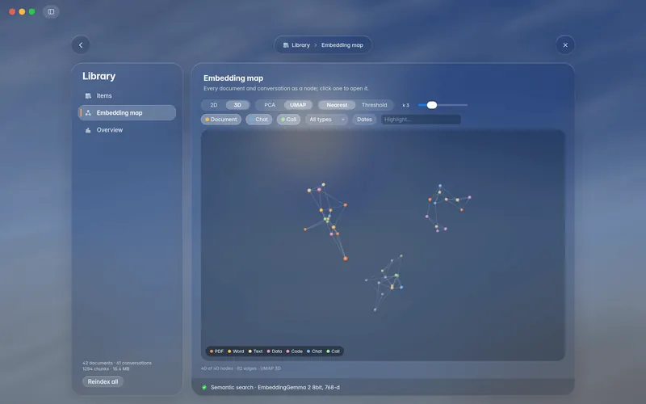</a> The same map in 3D. (mockup)</td>
  </tr>
</table>

<b>Mac · Voice studio & Voice ID</b> (2)

 

<table>
  <tr>
    <td width="33%" align="center" valign="top"><a href="docs/images/mac-voice-studio-1600.webp">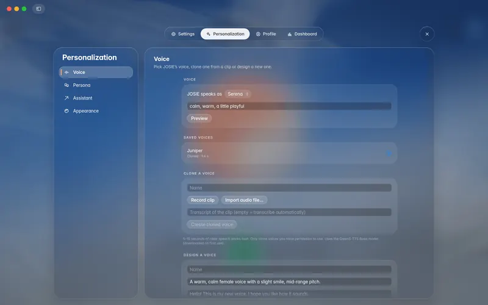</a> Pick a preset, clone a voice or design a new one. (mockup)</td>
    <td width="33%" align="center" valign="top"><a href="docs/images/mac-voice-id-1600.webp">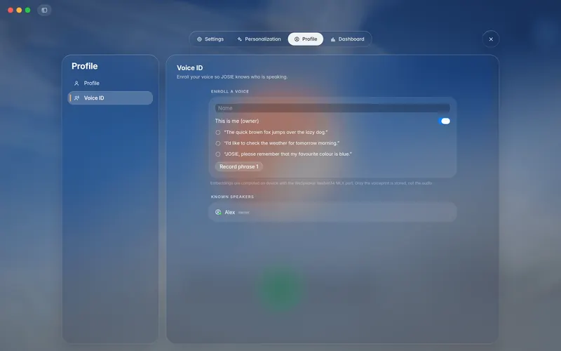</a> Teach JOSIE your voice with three phrases. (mockup)</td>
  </tr>
</table>

<b>Mac · Dashboard</b> (8)

 

<table>
  <tr>
    <td width="33%" align="center" valign="top"><a href="docs/images/mac-dashboard-overview-1600.webp">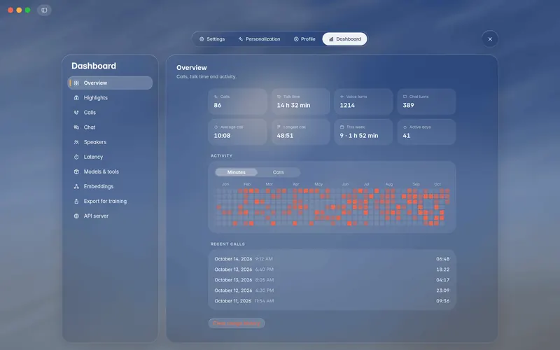</a> Overview: calls, talk time and activity. (mockup)</td>
    <td width="33%" align="center" valign="top"><a href="docs/images/mac-dashboard-highlights-1600.webp">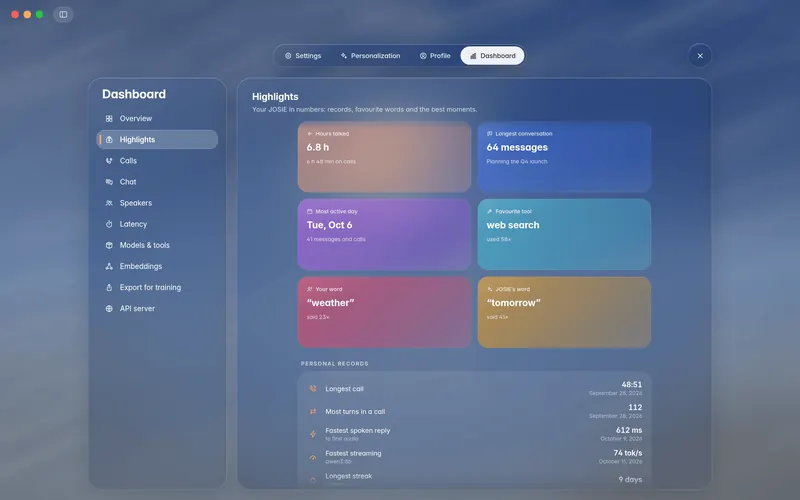</a> Highlights: your month, wrapped. (mockup)</td>
    <td width="33%" align="center" valign="top"><a href="docs/images/mac-dashboard-calls-1600.webp">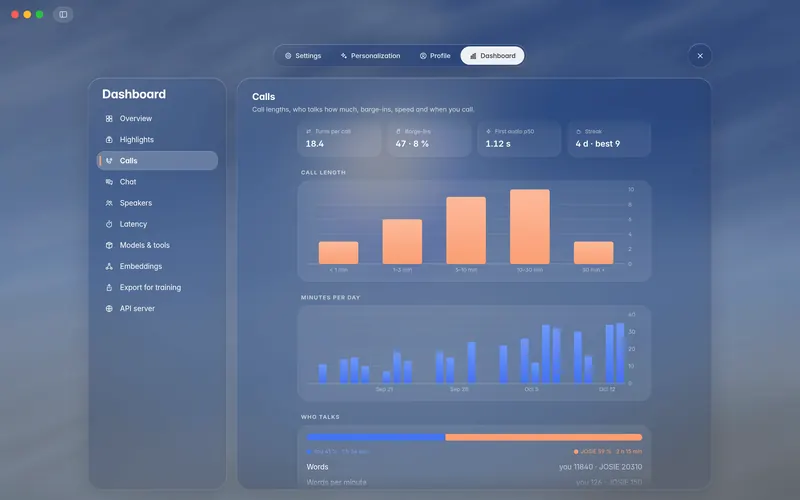</a> Calls: lengths, minutes per day and who talks. (mockup)</td>
  </tr>
  <tr>
    <td width="33%" align="center" valign="top"><a href="docs/images/mac-dashboard-chat-1600.webp">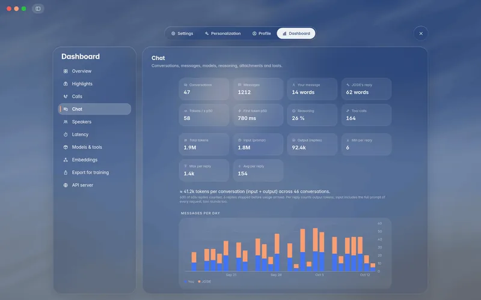</a> Chat: messages per day and models. (mockup)</td>
    <td width="33%" align="center" valign="top"><a href="docs/images/mac-dashboard-speakers-1600.webp">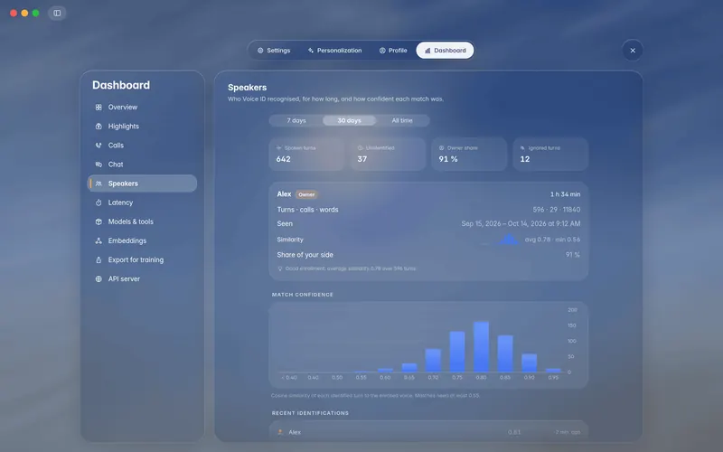</a> Speakers: how well JOSIE knows each voice. (mockup)</td>
    <td width="33%" align="center" valign="top"><a href="docs/images/mac-dashboard-latency-1600.webp">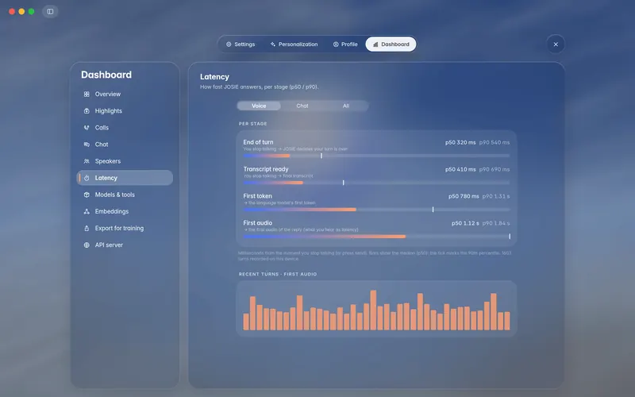</a> Latency for every stage of a voice turn. (mockup)</td>
  </tr>
  <tr>
    <td width="33%" align="center" valign="top"><a href="docs/images/mac-dashboard-embeddings-1600.webp">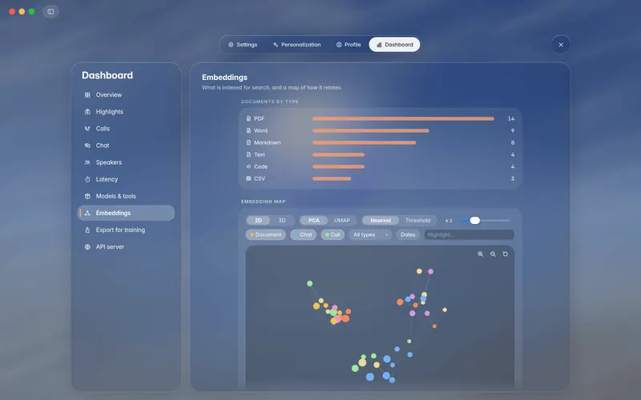</a> What's indexed for search. (mockup)</td>
    <td width="33%" align="center" valign="top"><a href="docs/images/mac-dashboard-export-1600.webp">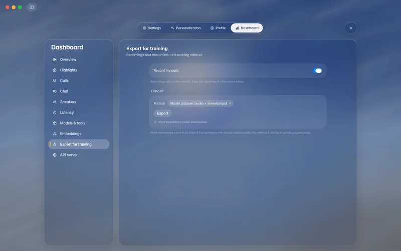</a> Export your calls for training. (mockup)</td>
  </tr>
</table>

<b>Mac · Menu bar & API server</b> (4)

 

<table>
  <tr>
    <td width="33%" align="center" valign="top"><a href="docs/images/mac-menu-bar-1600.webp">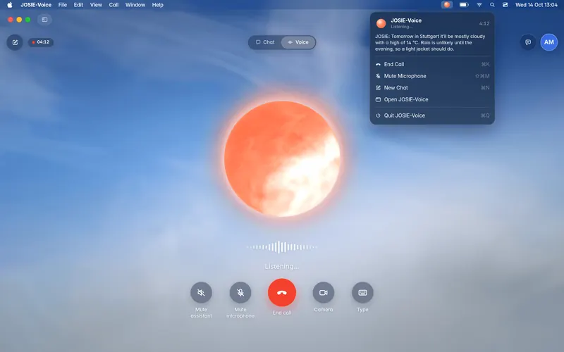</a> Calls and mute right from the menu bar. (mockup)</td>
    <td width="33%" align="center" valign="top"><a href="docs/images/mac-hub-menu-1600.webp">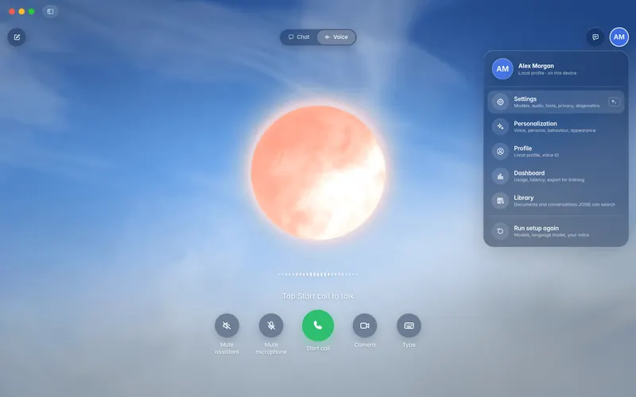</a> Everything else lives under your avatar. (mockup)</td>
    <td width="33%" align="center" valign="top"><a href="docs/images/mac-settings-api-1600.webp">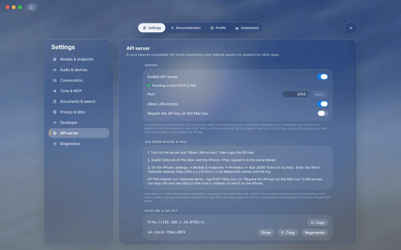</a> An optional local OpenAI-compatible API. (mockup)</td>
  </tr>
  <tr>
    <td width="33%" align="center" valign="top"><a href="docs/images/mac-dashboard-api-1600.webp">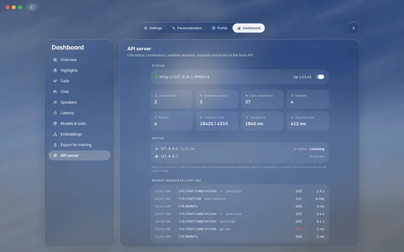</a> Watch the API server at work. (mockup)</td>
  </tr>
</table>

<b>Mac · Settings</b> (10)

 

<table>
  <tr>
    <td width="33%" align="center" valign="top"><a href="docs/images/mac-settings-models-1600.webp">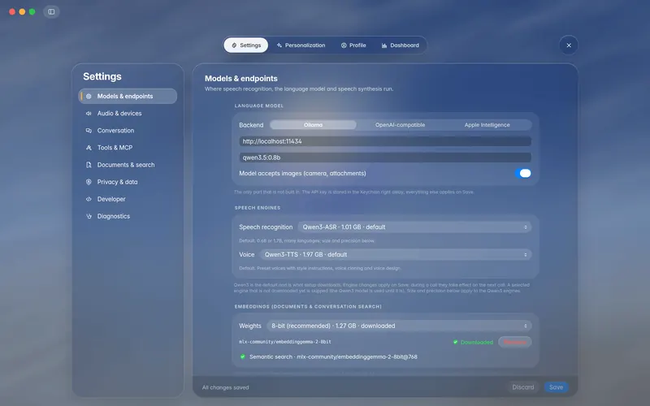</a> Models &amp; endpoints: Ollama by default. (mockup)</td>
    <td width="33%" align="center" valign="top"><a href="docs/images/mac-settings-speech-engines-1600.webp">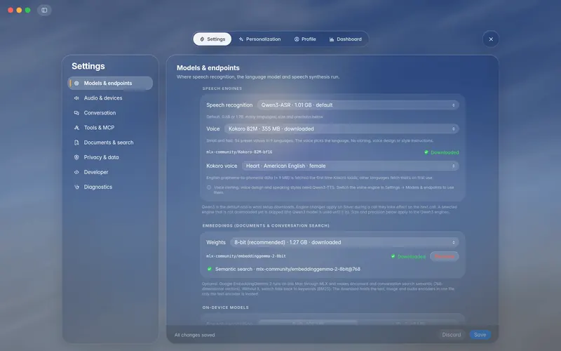</a> Choose the speech engines, like Kokoro 82M. (mockup)</td>
    <td width="33%" align="center" valign="top"><a href="docs/images/mac-settings-embeddings-1600.webp">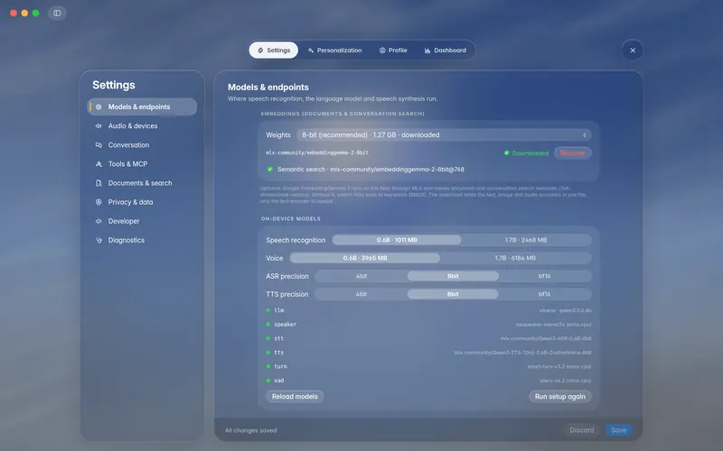</a> EmbeddingGemma for semantic search. (mockup)</td>
  </tr>
  <tr>
    <td width="33%" align="center" valign="top"><a href="docs/images/mac-settings-conversation-1600.webp">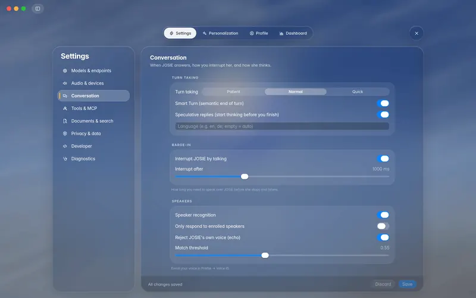</a> Turn taking, barge-in and speakers. (mockup)</td>
    <td width="33%" align="center" valign="top"><a href="docs/images/mac-settings-tools-1600.webp">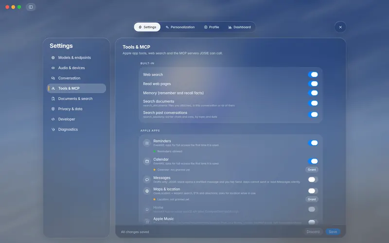</a> Built-in and Apple tools, each with its own switch. (mockup)</td>
    <td width="33%" align="center" valign="top"><a href="docs/images/mac-settings-documents-1600.webp">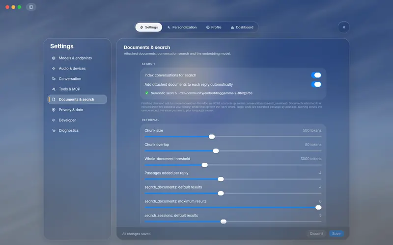</a> Documents &amp; search. (mockup)</td>
  </tr>
  <tr>
    <td width="33%" align="center" valign="top"><a href="docs/images/mac-settings-retrieval-1600.webp">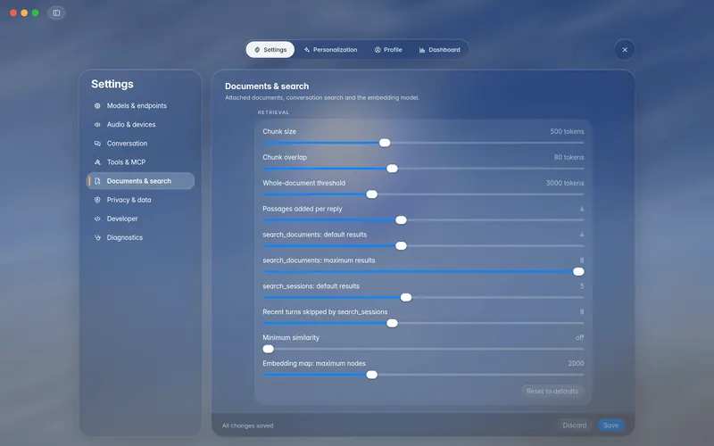</a> Fine-tune retrieval. (mockup)</td>
    <td width="33%" align="center" valign="top"><a href="docs/images/mac-settings-assistant-1600.webp">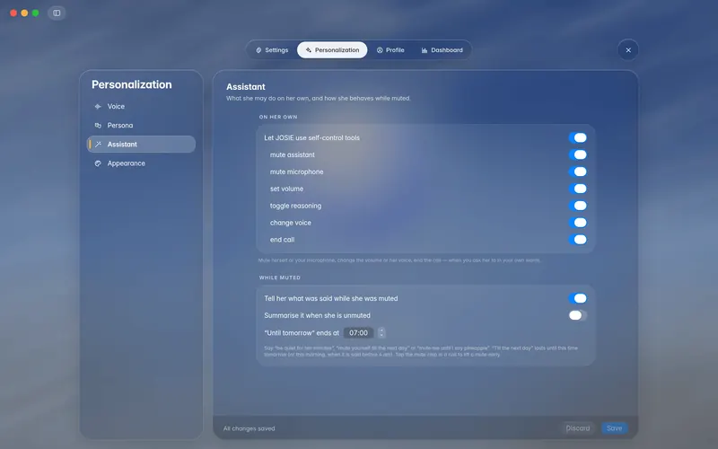</a> Self-control tools and mutes. (mockup)</td>
    <td width="33%" align="center" valign="top"><a href="docs/images/mac-settings-appearance-1600.webp">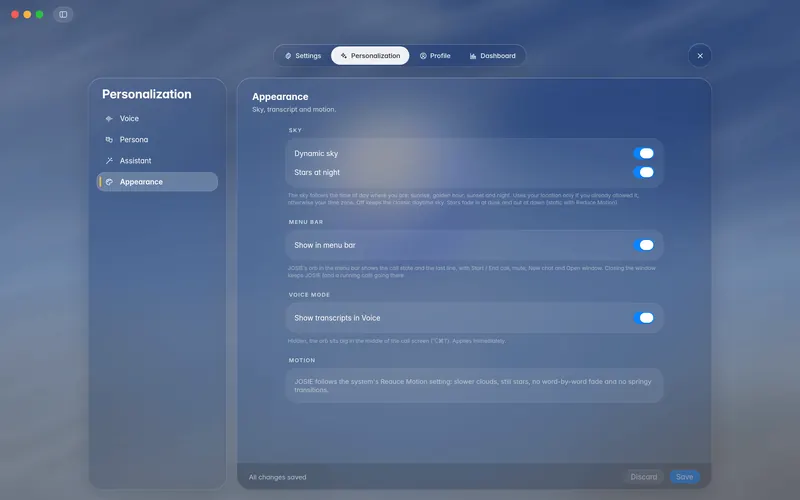</a> Dynamic sky, stars and the menu bar. (mockup)</td>
  </tr>
  <tr>
    <td width="33%" align="center" valign="top"><a href="docs/images/mac-settings-diagnostics-1600.webp">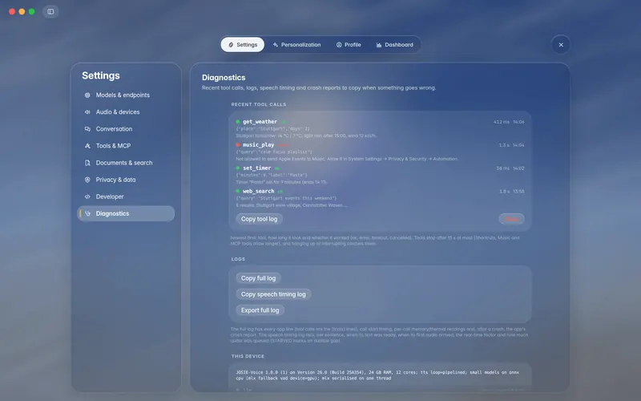</a> Diagnostics: recent tool calls and logs. (mockup)</td>
  </tr>
</table>

<b>Mac · Onboarding</b> (1)

 

<table>
  <tr>
    <td width="33%" align="center" valign="top"><a href="docs/images/onboarding-models-1600.webp">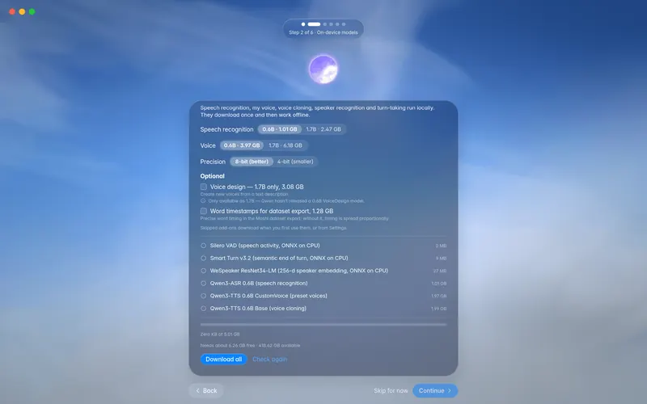</a> First launch: choose model sizes and download. (mockup)</td>
  </tr>
</table>

<b>iPhone · GPT-Live calls, Live Activity, onboarding and settings</b> (7)

 

On iPhone, calls use OpenAI GPT-Live or your own compatible server; no models run on the phone. Not available as a download yet.

<table>
  <tr>
    <td width="25%" align="center" valign="top"><a href="docs/images/ios-call.webp">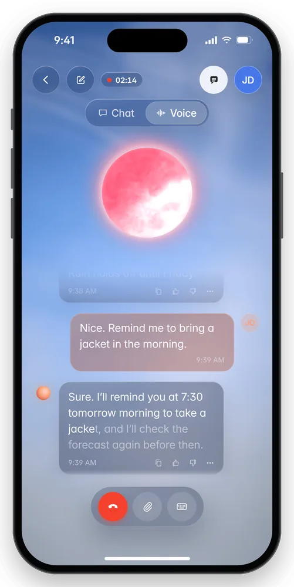</a> A GPT-Live call on the iPhone. (mockup)</td>
    <td width="25%" align="center" valign="top"><a href="docs/images/ios-live-activity.webp">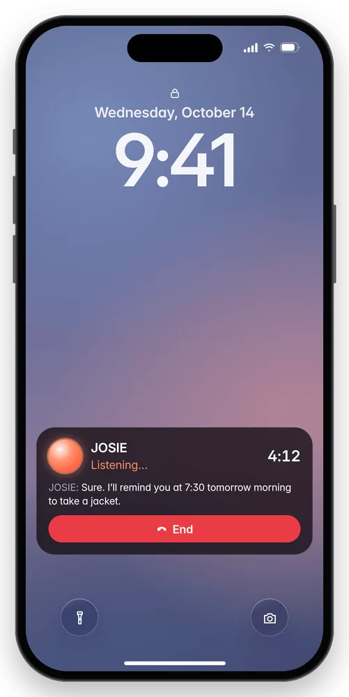</a> The call on the Lock Screen. (mockup)</td>
    <td width="25%" align="center" valign="top"><a href="docs/images/ios-dynamic-island.webp">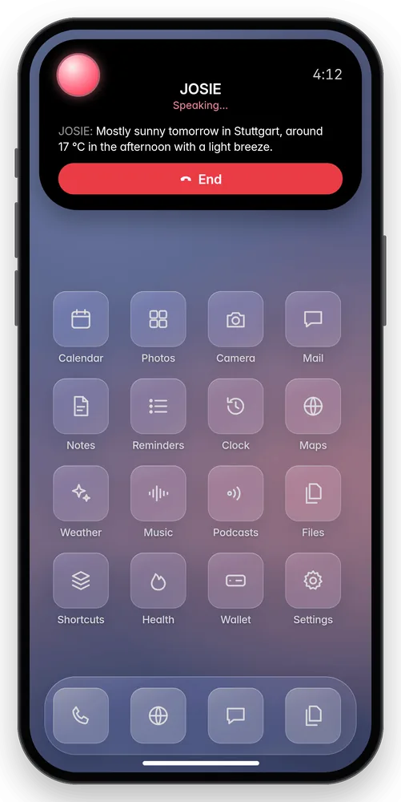</a> End the call from the Dynamic Island. (mockup)</td>
    <td width="25%" align="center" valign="top"><a href="docs/images/ios-onboarding-gpt-live.webp">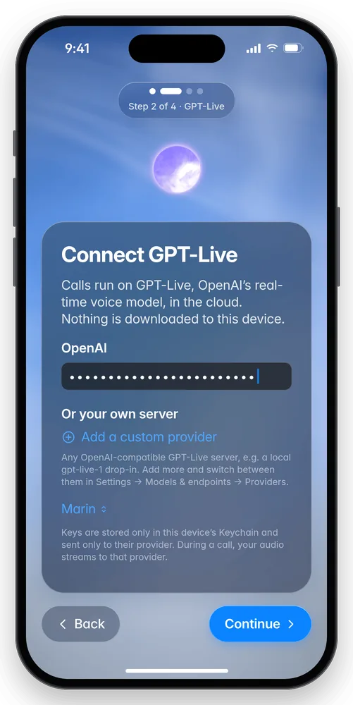</a> Connect GPT-Live in onboarding. (mockup)</td>
  </tr>
  <tr>
    <td width="25%" align="center" valign="top"><a href="docs/images/ios-onboarding-tour.webp">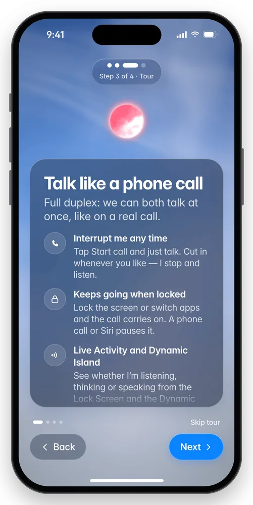</a> A short tour: talk like a phone call. (mockup)</td>
    <td width="25%" align="center" valign="top"><a href="docs/images/ios-settings-providers.webp">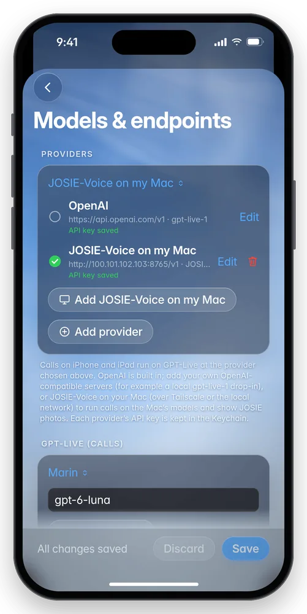</a> Providers: OpenAI or your own GPT-Live server. (mockup)</td>
    <td width="25%" align="center" valign="top"><a href="docs/images/ios-dashboard-calls.webp">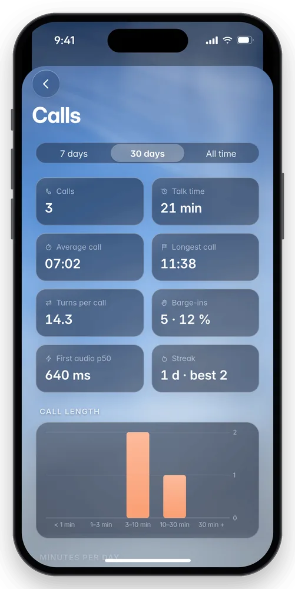</a> Your calls on the iPhone dashboard. (mockup)</td>
  </tr>
</table>

Every screenshot and clip here is a mockup rendered from the app's source with demo content, not a capture of a running build. Real captures will replace them.

## Gets things done

JOSIE works with the Apple apps you already use. Ask out loud and it really happens:

| App | Say | What happens |
|---|---|---|
| **Reminders** | "Remind me to bring a jacket at 7:30." | Added to Reminders, with the time set. |
| **Calendar** | "What's on tomorrow? Put lunch with Sam on Friday at noon." | Reads your day and adds the event. |
| **Maps** | "Find a pharmacy near me that's still open." | Looks up places and directions in Maps. |
| **Messages** | "Text Alex that I'm running ten minutes late." | Writes the draft in Messages. You tap Send. |

Each app is off until you turn it on in Settings → Apple tools, macOS asks your permission first, and nothing is sent without your tap.

## What Josie can do

| | |
|---|---|
| **Real conversation** | Knows when you've finished talking. Interrupt Josie just by speaking. |
| **Knows your voice** | Learns you from three short phrases and tells people apart. |
| **Voices you choose** | Pick a preset, clone a voice from a short recording, or describe a new one in words. |
| **Private by design** | Hearing, voice recognition and speech run on your Mac. Your data stays on your Mac. No account. |
| **Takes real action** | Adds reminders and events, finds places in Maps and drafts Messages (you tap Send). Each one is off until you turn it on. |
| **Sees what you show it** | Turn on the camera and ask about what it sees. Needs an image-capable model. |
| **Adapts to the room** | Volume follows background noise, with echo cancellation. |
| **Living sky** | The background follows the real time of day, under Apple's Liquid Glass design. |
| **Personas** | Talk to JOSIE, JARVIS, HAL 9000 or a character you write, each with its own prompt, voice and orb colour. |
| **Your iPhone, your Mac** | In the iPhone preview, pick your Mac as the provider, at home or over Tailscale. The call runs on your Mac, and you can show Josie a photo. |
| **Choose how it hears** | Speech recognition with Qwen3-ASR, NVIDIA Parakeet v3 or Apple's own on-device recognizer. All on your Mac. |
| **Its own chat prompt** | Write separate instructions for Chat and Voice. Muted in a call? Typed messages still get a text reply. |

## How it works

JOSIE-Voice is a native Mac app built with SwiftUI and MLX Swift. Everything except the language model runs on your Mac's Apple Silicon:

- **Listening:** Silero VAD notices when you speak, and Smart Turn v3 knows when you've finished.
- **Speech recognition:** Qwen3-ASR by default, or NVIDIA Parakeet TDT 0.6B v3 or Apple's on-device recognizer (chosen in Settings).
- **Who's speaking:** WeSpeaker, ported to MLX, recognises your voice and any voices you add.
- **Speech:** Qwen3-TTS by default, with voice cloning and voice design, or Kokoro 82M (chosen in Settings).
- **The brain:** a language model in [Ollama](https://ollama.com) on your Mac (`qwen3.5:0.8b` by default). In Settings you can switch to any OpenAI-compatible service with your own key, or to Apple Intelligence on macOS 26.

After setup, everything works offline except the language model, which runs in Ollama on your Mac.

## Good to know

- **Other models:** in Settings, switch to any OpenAI-compatible service with your own key, or to Apple Intelligence on macOS 26.
- **Run setup again:** Settings → Setup → Run setup again.
- **Apple tools:** turn them on one by one in Settings. macOS asks permission the first time each is used.
- **Optional extras** download only if you want them: voice design (3.1 GB) and word timestamps (1.3 GB).
- **For tinkerers:** Dashboard → Chat counts tokens per reply. Settings → Developer → Debug overlay shows live latency on the call screen.

## FAQ

**Can I download it?** Use Download for Mac on the website to download the newest published Mac DMG from [GitHub Releases](https://github.com/Goekdeniz-Guelmez/JOSIE-Voice/releases). If no DMG is published yet, the button links you to the releases page.

**Is it free?** Yes.

**Does my voice go to the cloud?** No. Hearing, voice recognition and speech run on your Mac, and by default the language model (Ollama) does too. If you switch to an online model, your text goes to that service.

**Do I need an account?** No.

**Does it work on Intel Macs?** No, Apple Silicon (M1 or later) only.

**Is there an iPhone or iPad version?** Not as a download yet. On iPhone and iPad, calls use OpenAI GPT-Live; see the iPhone screenshots above (mockups).

**It says "Ollama isn't running".** Open Ollama from Applications, then click Recheck in JOSIE's setup.

**JOSIE can't hear me.** Open System Settings → Privacy & Security → Microphone and turn on JOSIE-Voice.

**How much space does it need?** About 5 GB of voice models plus about 1 GB for the language model, at the default small sizes.

**How do I uninstall it?** Drag JOSIE-Voice to the Trash. To remove its data and models too, delete the `JOSIE-Voice` folder in `~/Library/Application Support`.

## The JOSIE family

JOSIE-Voice comes from the JOSIE family of personality-driven language models by Gökdeniz Gülmez, trained entirely on Apple Silicon with [MLX-LM-LoRA](https://github.com/Goekdeniz-Guelmez/mlx-lm-lora). Meet the models on [Hugging Face](https://huggingface.co/Goekdeniz-Guelmez).

 

## About this repository

This repository hosts the JOSIE-Voice website and visuals: the site lives in [`docs/`](docs/) and is served by GitHub Pages. The website resolves app downloads from GitHub Releases; the source code is private.

Built with MLX Swift, Qwen3-ASR, Qwen3-TTS, Parakeet, Kokoro, Silero VAD, Smart Turn v3 and WeSpeaker. Ollama is a separate app by its own developers.

Feedback: goekdenizguelmez.ml@gmail.com · [Sponsor on GitHub](https://github.com/sponsors/Goekdeniz-Guelmez)
